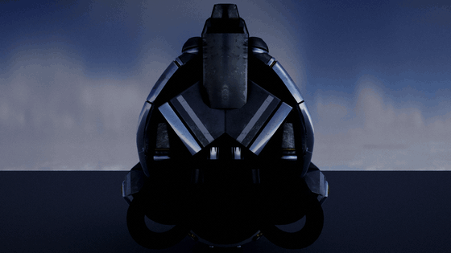
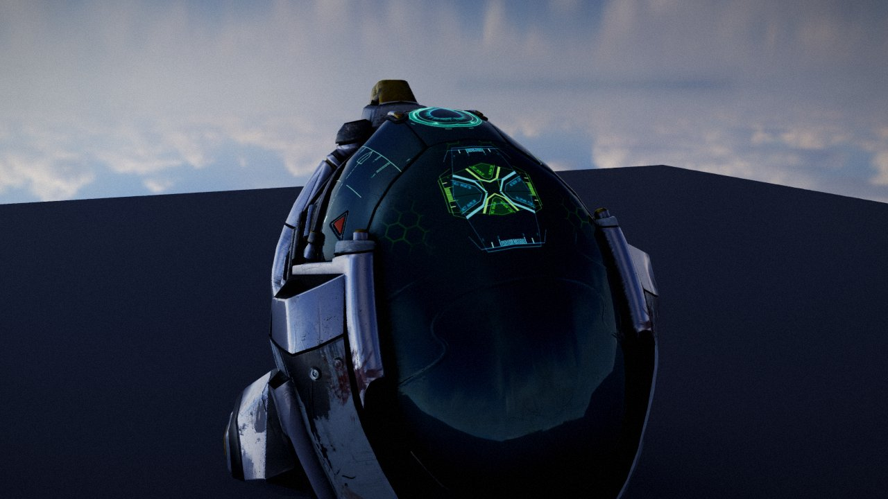
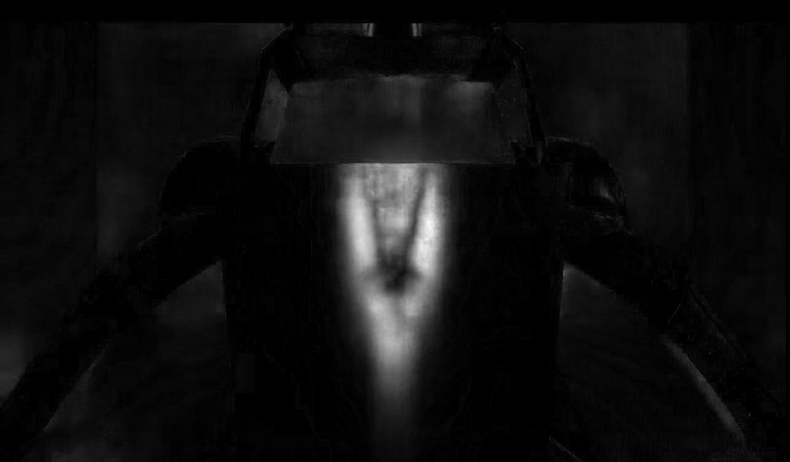
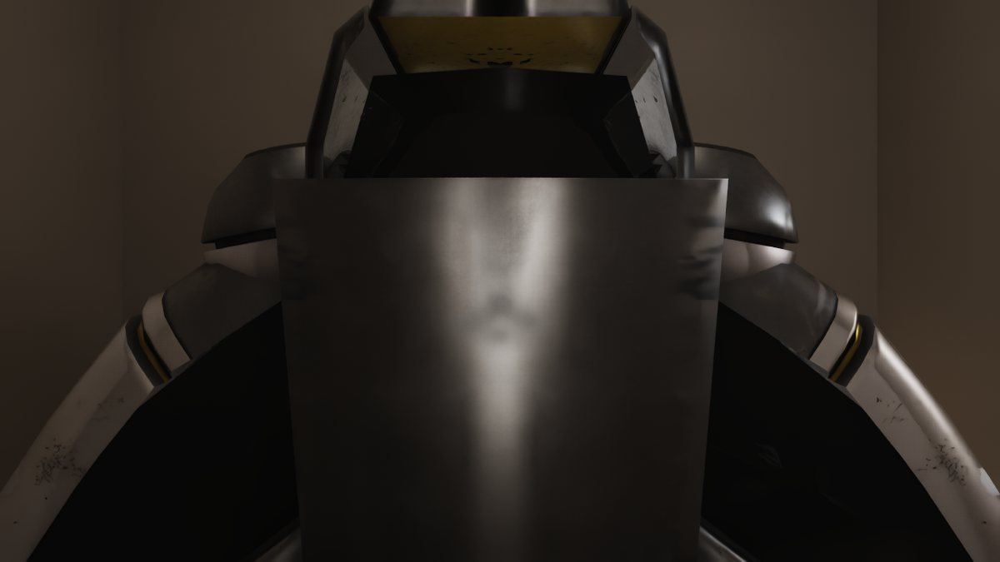

# OHAO Engine

A solo **Vulkan 1.3** hybrid renderer in **C++20**: KHR path tracing for ground truth and indirect light, deferred raster for real-time, shared scene / materials / TLAS. No editor host.

<p align="center">
  <!-- GitHub README strips <video>; animated GIF autoplays inline. Click opens the full MP4 on GitHub's video player. -->
  <a href="https://github.com/Qervas/ohao_engine/blob/master/docs/media/helmet_orbit.mp4">
    
  </a>
</p>

<p align="center">
  <a href="https://github.com/Qervas/ohao_engine/blob/master/docs/media/helmet_orbit.mp4">
    <strong>▶ Play full-quality orbit (MP4)</strong>
  </a>
  &nbsp;·&nbsp;
  <sub><em>Real-time path tracing ~67 fps — DLSS Ray Reconstruction · ReSTIR GI · cinematic grade. GIF loops above; the button opens the repo MP4 in GitHub’s player.</em></sub>
</p>

## What it is

Built to learn how a modern hybrid renderer is wired end to end. ~54K lines of **C++20** and ~17K lines of GLSL across 125 shaders, with two pipelines that share scene, materials, and acceleration structures. No engine SDK, no editor host. Path tracer is for ground truth. Deferred is for interactive iteration. The hybrid mode runs RT shadows and 1-bounce RT GI on top of the deferred G-buffer.

**Recent focus:** real-time path tracing at ~67 fps (1 spp, 720p) with DLSS Ray
Reconstruction and ReSTIR GI, and the environment-sampling work that made it
usable at one sample per pixel — see below.


## Headline numbers

| Metric | Value |
|---|---|
| Language | **C++20** |
| C++ source | ~54K LOC across `ohao/` |
| GLSL shaders | ~17K LOC across 125 files |
| Render code | ~26K LOC |
| GPU/Vulkan layer | ~10K LOC |
| Physics (Jolt) | ~11K LOC |
| ECS + asset loaders | ~3K LOC |
| Denoise backends | 3 (Intel OIDN, NVIDIA NRD, NVIDIA DLSS-RR) |

## Real-time path tracing — and the firefly that taught me the most

The most recent stretch pushed the `RTRealtime` path from noisy preview to real-time path tracing at 67 fps (1 spp, 720p), denoised with NVIDIA DLSS Ray Reconstruction and stabilized with ReSTIR GI. The fix I got the most out of, though, was the smallest one.



### The 1-spp firefly storm — importance sampling + MIS

**Symptom.** At one sample per pixel, metal and ground sparkled: bright pixels flashing at random every frame. Denoising couldn't touch it — the denoiser was being fed garbage.

**Cause.** The real-time integrator reached the bright HDRI environment *only* through random BSDF bounces. A rare ray that happened to land on the sun returned `radiance / (tiny pdf)` — a colossal spike. That's unbounded Monte-Carlo variance, by construction. The offline path already importance-sampled the environment; the real-time fork I'd split off didn't.

**Fix.** Importance-sample the environment by its own luminance (marginal + conditional CDF), shadow-trace, and MIS-weight against BSDF sampling with the balance heuristic:

```glsl
// shaders/rt/pt_raygen_realtime.rgen
sampleEnvMap(u1, u2, ..., out envDir, out envPdf);   // sample the sky where it's bright
if (dot(N, envDir) > 0.0 && envPdf > 0.0) {
    traceRayEXT(...);                                 // visibility toward the sampled dir
    if (payload.hitDist < 0.0) {                      // ray escaped -> it saw the env
        float w = misBalanceHeuristic(envPdf, bsdfPdfAtEnv);
        radiance += envRadiance * (diff + spec) * NdotL * w / envPdf;   // /envPdf cancels the spike
    }
}
```

**Lesson.** Variance isn't noise you denoise away — it's a sampling problem you solve at the source. A denoiser can only reconstruct a signal whose variance is already low. Every later win was the same move: cut variance *before* the denoiser, not after.

### The flicker that wasn't where it looked

Chrome on a test helmet flickered frame to frame. I built two plausible fixes — feeding DLSS the specular hit-distance guide, then swapping the glossy sampler for GGX VNDF importance sampling (Heitz 2018) — measured both with a drift-controlled A/B, and both came back *not* fixing it. The control gave it away: a diffuse wall that should read a temporal std of ~3 measured ~27. The ReSTIR-GI reservoir was still boiling, and the metal was just reflecting it — and a reflection is view-dependent, so the denoiser can't reproject the boil away the way it does on the walls.

| scene | metal flicker (temporal std) | fps (1 spp) |
|---|---|---|
| enclosed room | ~15 | ~35 |
| open HDRI scene | **0.69** | **67** |

The fix was the scene, not the sampler: an open environment reflects a stable sky instead of boiling GI, and one importance-sampled HDRI replaces four noisy area lights — ~20× less flicker and ~2× faster. Same lesson: ask *what* the pixel reflects before *how* the ray is aimed.

<p>
  
  
</p>

*Left: a per-pixel temporal-standard-deviation map — bright = flickering. The metal glows; the diffuse walls are black, which is what pointed at the reflection. Right: the enclosed room the flicker came from.*

I also tried **ReSTIR DI** for the direct lighting and reverted it — the weight calculation introduced more noise than it removed. Measuring that honestly and backing it out was the right call; ReSTIR GI on the indirect bounce stayed, and does the real variance reduction (3.2× less boil, unbiased).

## Architecture

Two pipelines, one scene. Both consume the same bindless texture array, the same material SSBO, the same TLAS. Switch at runtime via `--denoise=` and the example app argv.

```
                         scene + materials + lights
                                    |
                  +-----------------+-----------------+
                  |                                   |
            Path Tracer (rt/)                Deferred (deferred/)
            VK_KHR_ray_tracing_pipeline      G-buffer + lighting
            NEE + MIS + env-map IS           CSM, SSAO, SSR, SSS
            Sobol + Owen scramble            TAA, bloom, ACES
            OIDN / NRD / DLSS-RR denoise     (RT shadow + RT GI plug in here)
                  |                                   |
                  +----------------+------------------+
                                   |
                            output (PNG / swapchain)
```

### Path tracing

Lives in `ohao/render/rt/`. Vulkan KHR ray tracing pipeline. Files are split: `path_tracer.cpp` for the orchestrator, `path_tracer_descriptors.cpp` for the 30-binding descriptor layout, `path_tracer_images.cpp` for the AOV images, `path_tracer_pipeline.cpp` for the SBT, `path_tracer_render.cpp` for dispatch.

- The reference (offline) path tracer is `shaders/rt/path_tracer.slang`: a correct estimator of OpenPBR Surface's base (`shaders/material/openpbr.slang`: EON diffuse, GGX with bounded VNDF sampling, exact dielectric Fresnel, F82-tint metals, Kulla-Conty energy compensation), held to closed forms (`tests/renderer/check_material.py`, `check_analytic.py`)
- Next-event estimation to lights and the environment, weighed against BSDF sampling by the power heuristic; Russian roulette
- Environment map importance sampling: marginal + conditional CDFs built CPU-side in `env_cdf.cpp`
- Bindless textures (base colour, normal in the vertex tangents' frame, rough/metal, emissive, KHR specular)
- Alpha transparency via the any-hit shader for foliage and hair cards
- Both profiles run this tracer: the realtime one at 2 bounces, one sample a frame, denoised by NRD (or DLSS RR where the SDK is present)

### Denoising (three backends, runtime switchable)

All live in `ohao/render/rt/denoise/`.

| Backend | Files | Use |
|---|---|---|
| Intel OIDN 2.x | `oidn_denoise.cpp` | CPU post-process for offline reference |
| NVIDIA NRD 4.17 | `nrd_denoise.cpp`, `nrd_compose.cpp` | Realtime REBLUR diffuse + specular, the vendor-neutral realtime default |
| NVIDIA DLSS-RR | `dlss_rr.cpp` | Ray Reconstruction, the realtime default on NVIDIA (SDK fetched by `tools/fetch_dlss.py`) |

`--denoise=optix` is still parsed and falls back to OIDN with a warning; that backend was removed in `0873766`.

### Deferred raster

`ohao/render/deferred/`. G-buffer with position, normal, albedo, rough/metal, emissive. Lighting pass uses the same bindless texture array as RT.

- Cascaded shadow maps (CSM) with skinned variant for animated meshes
- SSAO, SSR (screen-space reflections), SSS (subsurface scattering)
- TAA with Halton jitter, bloom, ACES tonemapping
- HDR environment reflection, Fresnel-weighted

### Hybrid composite

`render/rt/rt_shadow_technique.*` and `render/rt/rt_gi_technique.*` plug into the deferred G-buffer. RT shadows are traced from the G-buffer's reconstructed world position. RT GI is 1-bounce indirect with temporal blending (see header comment in `rt_gi_technique.hpp`). Both run on the same TLAS the path tracer uses.

### Acceleration structures

`rt_acceleration_structure.cpp` handles BLAS/TLAS lifecycle.

### Subsystem map

```
ohao/
  core/          828 LOC  logging, events, commands
  gpu/vulkan/  9,639 LOC  device, memory, descriptors, dispatch
  render/     25,748 LOC  scene/ (RenderScene), rt/, deferred/, graph/, ibl/, particles/, picking/, async/
  ecs/           707 LOC  EnTT world, transform system, render extract, spawn helpers
  scene/asset/ 2,556 LOC  loaders (gltf/obj/fbx via Assimp)
  physics/    11,083 LOC  Jolt 5.1 backend behind IPhysicsBackend plugin
  audio/         476 LOC  miniaudio backend
shaders/      17,058 LOC  125 files, mostly rt/, core/, postprocess/, compute/
```

## Build

```bash
cmake -B build -S . -DFETCHCONTENT_UPDATES_DISCONNECTED=ON
cmake --build build -j8
cmake --build build --target shaders   # shaders only
```

Requires CMake 3.20+, Vulkan SDK 1.3+ with RT extensions, a **C++20** compiler. Tested on Linux with GCC/Clang and on Windows with MSVC.

## Run

```bash
./build/cornell_box       output.png 1024                 # 1024 spp path-traced reference
./build/cornell_box       output.png 1   deferred         # deferred + RT hybrid
./build/model_viewer      model.glb  output.png 256       # GLB in Cornell box, OIDN denoised
./build/model_viewer      model.fbx  output.png 1 deferred # FBX geometry via Assimp
./build/env_demo          model.glb  env.hdr output.png 256
./build/turntable         model.glb  mirror 256 480       # turntable video frames
./build/renderer_test                                      # smoke test
```

All examples accept `--denoise=none|oidn|nrd|dlss`; `rt_realtime` selects the real-time path tracer, which denoises with NRD's REBLUR_DIFFUSE_SPECULAR or DLSS-RR.

The game host renders the **Deferred** raster path (with RT shadows and RT GI where the GPU supports them) straight to a window:

```bash
./build/Release/ohao_game.exe            # windowed: WASD/QE move, right-drag look, Shift fast, Esc quits, --vsync
OHAO_VALIDATION=1 ./build/Release/ohao_game.exe --frames 600 --resize-at 200   # presentation gate: exit 0 = no validation messages, no readbacks
```

## Dependencies

- Vulkan SDK 1.3+ with RT extensions
- GLFW 3.x (`ohao_game` window and input)
- Intel OpenImageDenoise 2.x
- NVIDIA NRD (RayTracingDenoiser) v4.17, fetched via FetchContent. Pure Vulkan, no CUDA. Opt out with `-DOHAO_NRD=OFF`.
- Jolt Physics 5.1.0, Assimp 5.4.3, stb, glm, VMA, nlohmann/json (all FetchContent)

## Project status

See **`CHANGELOG.md`** for the current line (C++20 refactor, hybrid RT stack, golden harness). High points:

- Real-time path tracing with **DLSS-RR**, **ReSTIR GI**, and outdoor HDRI showcase (see [above](#real-time-path-tracing--and-the-firefly-that-taught-me-the-most)).
- **NRD** REBLUR + cinematic post is shippable for interactive quality (`--denoise=nrd`).
- Pre-push **golden-image** regression (`tests/golden/`).
- ReSTIR DI was tried and reverted (added more noise than it removed).

**Moved out or removed**, listed because the README described some of it long
after the fact:

- **Differentiable and inverse rendering are not part of this engine.** The
  differentiable renderer moved out to its own repository; the
  inverse-rendering lab was removed in `e0a260b`. This is a game engine.
- **Animation, the OptiX denoiser, the tscn loader and scene serialization**
  were removed in `0873766`. `--denoise=optix` is still accepted on the command
  line and falls back to OIDN with a warning.
- **The GLSL realtime path tracer** (`pt_raygen_realtime.rgen`) and its ReSTIR GI,
  internal spatial denoiser and pre-OpenPBR BRDF were removed on 2026-10-30
  (`docs/specs/2026-10-30-frontier-renderer-design.md`, step F1): both path tracer
  profiles run the OpenPBR reference tracer. The real-time path tracing write-up
  above describes that earlier tracer.

Deeper docs: `docs/render_pipelines.md`, `docs/bugs_solved/`, and the monograph in `site/`.

## Known build gotchas

These bit me, listed so they don't bite you:

- Linux: `#ifdef _WIN32` guards around Vulkan external memory extensions
- GCC: `-Wl,--start-group ... --end-group` for circular static lib deps
- GCC strict mode: missing `<cstring>` and `<algorithm>` includes in some upstream headers
- stbi duplicate symbols: `--allow-multiple-definition` on Linux, `/FORCE:MULTIPLE` on MSVC
- Shutdown order matters: the ECS world and RenderScene before VulkanRenderer, PathTracer before VkDevice

## Third-party SDKs

- **NVIDIA DLSS** (Ray Reconstruction) is used under the NVIDIA RTX SDKs licence. It is not part
  of this repository: `python tools/fetch_dlss.py` downloads the pinned SDK files into the
  git-ignored `external/DLSS`, and the build turns DLSS on when they are present. The realtime
  path tracer uses it on NVIDIA GPUs; elsewhere it uses NRD. NVIDIA, DLSS and the DLSS logo are
  trademarks of NVIDIA Corporation.

## License

MIT, see [LICENSE](LICENSE). Built by Frank Yin ([@Qervas](https://github.com/Qervas)).
