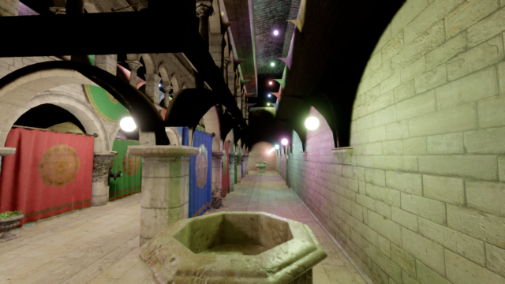
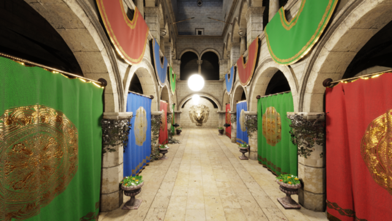
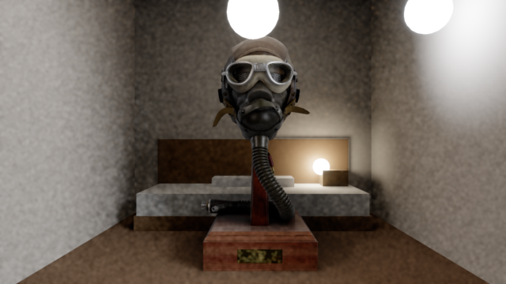
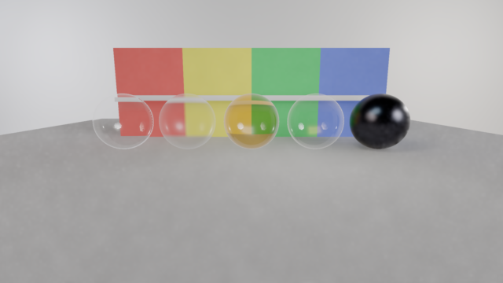
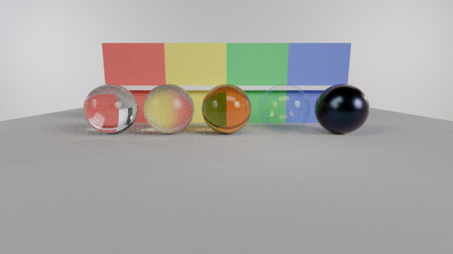
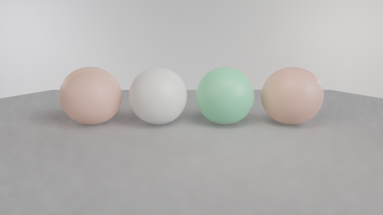
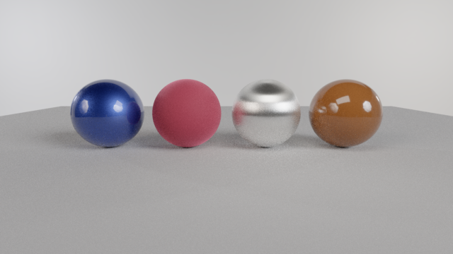
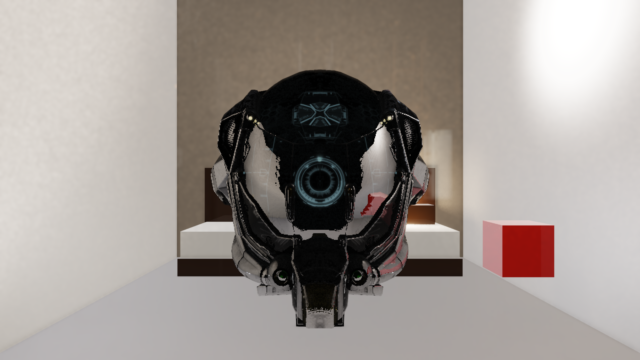
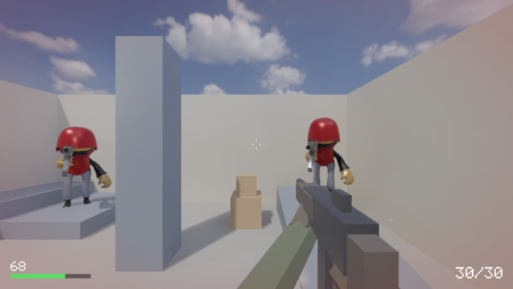
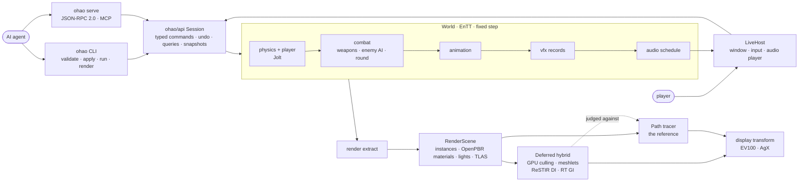

# OHAO

**A C++20 / Vulkan game engine that AI agents can drive, with a real-time renderer checked against its own path tracer.**

<p align="center">
  
  <br>
  <sub>Sponza at night, lit by 37 lamps with no sun and no sky. Every lamp casts ray-traced shadows through ReSTIR DI, and every bounce comes through RT GI. This is the real-time deferred frame.</sub>
</p>

## Why OHAO

Most engines are built around a person sitting in an editor, and agents get access later through plugins that drive that editor. OHAO starts from the agent side. Every authoring operation goes through one typed API with undo. Scenes are canonical JSON files with a published schema. Worlds step deterministically, so an agent can load a level, edit it, play it, capture what it sees and replay the session bit for bit, through the `ohao` CLI or a live engine over MCP. An editor, when there is one, will be another client of that same API.

The renderer is checked against a reference. A single material model, OpenPBR Surface, runs in both the hybrid deferred frame and the path tracer. The path tracer is held to closed-form results, and the deferred frame is held to the path tracer. On every reference scene, deferred stays within 0.16 stops of the path tracer (the bar is half a stop).

The first game is a first-person combat slice: one level, a player, a rifle, two enemies that see, chase and shoot, and a round that restarts to its first frame bit for bit. Its job is to prove the engine. The standard it aims for is production AAA.

## Showcase

All of these are render goldens from [`tests/golden/`](tests/golden/manifest.json). The suite re-renders every one of them on each full check.

<table>
  <tr>
    <td width="50%"></td>
    <td width="50%"></td>
  </tr>
  <tr>
    <td><sub><b>Sponza by day.</b> The Khronos Sponza under a sun, five atrium lamps and an HDRI sky. The sky lights the scene through RT GI's rays, and specular reflections are RT GI's reflection rays (there is no SSR).</sub></td>
    <td><sub><b>FlightHelmet.</b> The Khronos model with its blended lenses drawn by the sorted forward pass. Each lamp is also a mesh the camera can see.</sub></td>
  </tr>
  <tr>
    <td></td>
    <td></td>
  </tr>
  <tr>
    <td><sub><b>Glass, deferred.</b> Clear, frosted, amber, a thin-walled bubble with a thin film, and anodised metal. Each fragment traces its way through the solid with ray queries.</sub></td>
    <td><sub><b>The same glass, path traced</b> at 16 samples per pixel with no denoiser. This is the reference the deferred image is judged against.</sub></td>
  </tr>
  <tr>
    <td></td>
    <td></td>
  </tr>
  <tr>
    <td><sub><b>Subsurface:</b> skin-like, marble, jade and a diffuse reference. In the deferred frame a Burley profile spreads the diffuse light; the path tracer runs a random walk through the volume.</sub></td>
    <td><sub><b>OpenPBR's layers, path traced:</b> car paint (coat), velvet (fuzz), brushed metal (anisotropy) and lacquered wood.</sub></td>
  </tr>
  <tr>
    <td></td>
    <td></td>
  </tr>
  <tr>
    <td><sub><b>DamagedHelmet</b> in a lit room, with emissive panels, clustered lights, TAA and bloom.</sub></td>
    <td><sub><b>The slice, 45 steps into the fight:</b> two skinned enemies, the player's arms and rifle, and the HUD. A window and a headless host reach this exact picture.</sub></td>
  </tr>
</table>

## How it fits together



Every host runs the same `World`: the CLI, `ohao serve`, the tests and the game window. Its systems run in a fixed order each step: physics, combat, animation, effects, then the audio schedule. Each one writes saved, hashable state or a runtime log that snapshots carry with them. The render extract is the only bridge into the renderer, and the renderer never sees EnTT. [docs/ARCHITECTURE.md](docs/ARCHITECTURE.md) has the full map and a recipe for each common change.

## The renderer

**One material model in every renderer.** [OpenPBR Surface 1.1.1](https://academysoftwarefoundation.github.io/OpenPBR/) is written once as a Slang module (`shaders/material/openpbr.slang`). It covers EON diffuse, energy-compensated GGX, F82-tint metals, coat, fuzz, anisotropy, glass with dispersion and thin film, and subsurface. The deferred frame, RT GI's hits, the transparent pass and the path tracer all import it. White materials in a white furnace come back within 1%, on the CPU and in both renderers.

**A hybrid frame with ray-traced lighting.** The G-buffer is drawn by GPU-driven indirect draws, with two-pass Hi-Z culling and meshlets through mesh shaders (or their compute fallback). ReSTIR DI shades direct light from any number of lights and emissive triangles, using MegaLights' sample, trace, shade and denoise structure, so every light is shadowed by rays. RT GI carries every bounce through a world-space radiance cache, and its reflection ray provides specular indirect light. There is no SSR and no fill light: indirect light comes from rays, or from the environment when the GPU has no ray tracing.

**A path tracer you can trust.** `shaders/rt/path_tracer.slang` is a correct estimator of OpenPBR. It uses light, environment and BSDF sampling weighted by the power heuristic, emissive triangles as lights chosen by power, and Owen-scrambled Sobol sequences. A real-time profile runs the same tracer at two bounces, terminates paths in a radiance cache, and denoises with DLSS Ray Reconstruction on NVIDIA or NRD elsewhere.

**One way to show a frame.** Every image passes through the same display transform: EV100 exposure, AgX or Khronos PBR Neutral, and the sRGB curve. A physical sky lights scenes that have no HDRI, and bloom moves energy without adding any. A capture looks the same whichever mode produced it.

**Deterministic by default.** Deferred frames are identical bit for bit across runs and processes. Path-traced frames repeat to within a 1-LSB floor that comes from the driver's BVH builds. All shaders are Slang.

## The game

The engine includes the systems a shooter needs, and each of them replays exactly from a snapshot:

- **Physics and the player.** Jolt runs inside the fixed step, with a `CharacterVirtual` player that walks, sprints, jumps, climbs steps and pushes crates. It also provides contact and trigger events, footsteps by surface, and joints as scene data.
- **Combat.** Hitscan weapons have spread, bloom, recoil, magazines and ADS. Enemies see, chase and fire in bursts. The round restarts to its first `world.hash`.
- **Animation.** Our own glTF skin and clip reader feeds animation graphs stored as saved integers. GPU skinning feeds the G-buffer, meshlets, motion vectors and a refitted BLAS, so shadows and GI see the deformed mesh.
- **Audio.** A miniaudio mixer has buses, ducks, snapshots, a Freeverb return per reverb zone and occlusion graded by walls. The step decides every sound through a voice schedule that replays exactly.
- **VFX.** Effects are spawn records from the step, drawn in closed form. They include lit, soft particles, sorted forward transparency, projected decals, tracers, and smoke that dims RT shadows and GI.
- **Feel.** The game measures input-to-present latency, and the camera turns every frame by a presentation-only look lead.

Levels are authored in Blender and exported as glTF. Node `extras` become components, and collision is fitted from the meshes.

## Driven by agents

The `ohao` CLI reads, validates, edits, steps and renders scenes without a GPU unless it is asked to render. Its stdout is always JSON, and its diagnostics point into the file with JSON pointers.

```console
$ build/Release/ohao.exe summary assets/scenes/blockout_play.scene.json --depth 1
$ build/Release/ohao.exe run assets/scenes/blockout_play.scene.json --steps 45 --render fight.png --hud
```

`ohao serve` exposes the same API as a live session over JSON-RPC 2.0 and MCP, headless or in a window. It provides 39 tools: load, edit with undo, step in lockstep or real time, inject input, record and replay, capture frames inline, read logs, and query physics, combat, animation, audio and VFX. A Claude Code project connects with one `.mcp.json` entry. See [docs/agents/ohao-serve.md](docs/agents/ohao-serve.md) and [docs/agents/ohao-cli.md](docs/agents/ohao-cli.md).

The engine is built to be developed by agents too. [AGENTS.md](AGENTS.md) is the entry point. `python tools/check.py` builds everything and runs every gate (unit suites, GPU tests, validation, render goldens and benchmarks), then writes one machine-readable verdict.

## Quick start

You need Linux with GCC and Ninja (the platform in daily use) or Windows with MSVC, CMake 3.20 or newer, the Vulkan SDK 1.3, `slangc` from Slang's own release at the versions pinned in `shaders/slangc.version` (SPIR-V) and `shaders/slangc_cpp.version` (the CPU twins' C++), on Linux unpacked into `~/.local/opt/slang-<version>`, where configure finds them, Python 3, and a GPU with Vulkan ray tracing for the RT paths. Use a real CMake: if conda's `cmake` comes first on your PATH, call the real one by its full path.

```console
$ cmake -B build -S .
$ cmake --build build --config Release -j6
$ python tools/check.py
```

Then play the slice, render a frame, or open a live session:

```console
$ build/Release/ohao_game.exe assets/scenes/blockout_play.scene.json
$ build/Release/ohao.exe run assets/scenes/sponza_night.scene.json --render night.png --mode deferred --frames 30
$ build/Release/ohao.exe run assets/scenes/glass.scene.json --render glass.png --mode rt_offline --spp 256
$ build/Release/ohao.exe serve --window 1280x720 assets/scenes/blockout_play.scene.json
```

In the slice, WASD walks, Shift sprints, Space jumps, the left mouse button fires, the right one aims, R reloads, G throws a test grenade, Enter restarts and Esc frees the mouse. NRD is fetched at configure time. DLSS Ray Reconstruction turns on when `python tools/fetch_dlss.py` has placed the SDK in `external/DLSS`. OIDN is used if CMake finds it.

## Roadmap

The full table, with specs and change records, is in [docs/ROADMAP.md](docs/ROADMAP.md).

| | |
|---|---|
| **Built** | Runtime shell; ECS world and persistent GPU scene; reflection, canonical scene files and the CLI; the agent control surface (`ohao serve`); the GPU-driven renderer upgrade; the level pipeline; the player; combat; OpenPBR materials (all four steps); the frontier renderer (one path tracer, ReSTIR DI, multi-bounce RT GI, the physical display chain, Slang everywhere) |
| **Built, awaiting hand test** | Feel (latency, look lead, view-model), animation, audio, VFX and transparency |
| **In progress** | **Path guiding** (23): Markov chain path guiding in the offline tracer, off by default while it is measured. **Caustics** (24): light traced from the sun through smooth surfaces, then specular manifold sampling for caustics seen through glass, being built on a branch. **Joints and ragdolls** (13): joints are scene data; death ragdolls are next |
| **Next** | Destruction (19), cloth and soft bodies (20), simulated GPU particles (21), then fluids (22) when needed. Gameplay physics stays on the CPU and replays bit for bit, and GPU simulation is presentation only. Not yet ordered: the game module with hot reload (14) and the asset database (15). Scheduled when needed: rendering to a budget (16) and OpenUSD interop (8) |

## Acknowledgements

OHAO implements these published techniques. Each one is our own code unless the note says otherwise.

| Where | Work |
|---|---|
| Materials | **OpenPBR Surface 1.1.1** (Academy Software Foundation; reference implementation in MaterialX) |
| | Portsmouth, Kutz & Hill, *EON: A practical energy-preserving rough diffuse BRDF*, JCGT 2025: ported from the authors' listings (MIT, [`LICENSE-EON.md`](shaders/material/LICENSE-EON.md)) |
| | Zeltner, Burley & Chiang, *Practical Multiple-Scattering Sheen Using Linearly Transformed Cosines*, SIGGRAPH Talks 2022: the fits ported from MaterialX (Apache-2.0, [`LICENSE-MaterialX.md`](shaders/material/LICENSE-MaterialX.md)) |
| | Kutz 2021 (the F82-tint Fresnel); Kulla & Conty 2017 and Turquin 2019 (energy compensation); Heitz 2014 (height-correlated Smith); Eto & Tokuyoshi 2023 (bounded VNDF sampling); Walter et al. 2007 (rough refraction); Belcour & Barla 2017 (*A Practical Extension to Microfacet Theory for the Modeling of Varying Iridescence*); van de Hulst's albedo inversion |
| | Chiang, Kutz & Burley 2016 (random-walk subsurface); Christensen & Burley 2015 (normalized diffusion profile); Jimenez et al. 2015 (the pre- and post-scatter split) |
| Area lights | Heitz, Dupuy, Hill & Neubelt 2016 (linearly transformed cosines) with Heitz 2017's edge integral; Karis 2013 (representative-point sphere lights) |
| Direct light | Bitterli et al., *Spatiotemporal reservoir resampling for real-time ray tracing with dynamic direct lighting*, SIGGRAPH 2020 (ReSTIR DI); Bitterli 2022, thesis §5.8 (pairwise MIS); Narkowicz & Costa, *MegaLights*, SIGGRAPH 2025 (the frame's structure); Schied et al. 2017 (SVGF's luminance-guided filter) |
| Indirect light | NVIDIA's SHaRC design, built as our own code (RTXGI's licence does not allow vendoring), after Binder et al., *Fast Path Space Filtering by Jittered Spatial Hashing*, SIGGRAPH 2019 talks, and Gautron, SIGGRAPH 2020; Walker 1977 and Vose 1991 (alias tables) |
| Sampling | Burley, *Practical Hash-based Owen Scrambling*, JCGT 2020; Duff et al. 2017 (orthonormal bases); Steele, Lea & Flood 2014 (splitmix64) |
| Path guiding | Alber, Hanika & Dachsbacher, *Real-Time Markov Chain Path Guiding for Global Illumination and Single Scattering*, 2025: implemented from the paper (the authors' code is GPL-2.0 and is not read, copied or linked). Also Dittebrandt et al., CGF 2023; Ruppert, Herholz & Lensch, SIGGRAPH 2020; Banerjee et al. 2005; Jakob 2012; West et al. 2020 |
| Caustics (in progress) | Zeltner, Georgiev & Jakob, *Specular Manifold Sampling for Rendering High-Frequency Caustics and Glints*, SIGGRAPH 2020; Hanika, Droske & Fascione 2015 (manifold next-event estimation); Veach 1996 (non-symmetric scattering) |
| Display and sky | Hillaire, *A Scalable and Production Ready Sky and Atmosphere Rendering Technique*, EGSR 2020, with Bruneton's transmittance parametrisation; Lagarde & de Rousiers, *Moving Frostbite to PBR*, SIGGRAPH 2014 (physical exposure); AgX (Sobotka), as fit by Wrensch's *Minimal AgX* 2023; Khronos PBR Neutral 2024; Jimenez 2014 (bloom pyramid); Salvi 2016 (TAA variance clipping) |
| Audio | Jezar's Freeverb (public domain), written as our own node |

### Libraries

[Jolt Physics](https://github.com/jrouwe/JoltPhysics) 5.1 · [EnTT](https://github.com/skypjack/entt) 3.13 · [miniaudio](https://github.com/mackron/miniaudio) 0.11.21 · [simdjson](https://github.com/simdjson/simdjson) · [fast_float](https://github.com/fastfloat/fast_float) · [nlohmann/json](https://github.com/nlohmann/json) · [Assimp](https://github.com/assimp/assimp) 5.4.3 · [ufbx](https://github.com/ufbx/ufbx) · [GLFW](https://github.com/glfw/glfw) 3.4 · [glm](https://github.com/g-truc/glm) · [stb](https://github.com/nothings/stb) · [Vulkan Memory Allocator](https://github.com/GPUOpen-LibrariesAndSDKs/VulkanMemoryAllocator) · [unordered_dense](https://github.com/martinus/unordered_dense) · [Slang](https://github.com/shader-slang/slang) (from the Vulkan SDK) · [NVIDIA NRD](https://github.com/NVIDIAGameWorks/RayTracingDenoiser) 4.17 with NRI (fetched at configure time) · [Intel Open Image Denoise](https://github.com/RenderKit/oidn) (optional) · [GoogleTest](https://github.com/google/googletest) and [Boost.PFR](https://github.com/boostorg/pfr) (tests only). Each one is used under its own licence.

**NVIDIA DLSS** Ray Reconstruction is used under the NVIDIA RTX SDKs licence. It is never committed to this repository: `tools/fetch_dlss.py` downloads the pinned SDK into the git-ignored `external/DLSS`. NVIDIA, DLSS and the DLSS logo are trademarks of NVIDIA Corporation.

### Assets

- From the Khronos glTF-Sample-Models ([`assets/khronos/`](assets/khronos/README.md), with full credits): Sponza (Crytek's public donation), Flight Helmet (CC0, donated by Microsoft) and Metal-Rough Spheres (CC BY 4.0, © 2017 Analytical Graphics, Inc.).
- The enemy is "Character Enemy" from Quaternius' Toon Shooter Game Kit (CC0), rebuilt by `tools/anim/make_enemy.py`.
- The blockout level, the player's arms and rifle, and every sound and VFX texture are generated by scripts in `tools/` and are MIT.

## Licence

MIT. See [LICENSE](LICENSE). Built by Frank Yin ([@Qervas](https://github.com/Qervas)).
