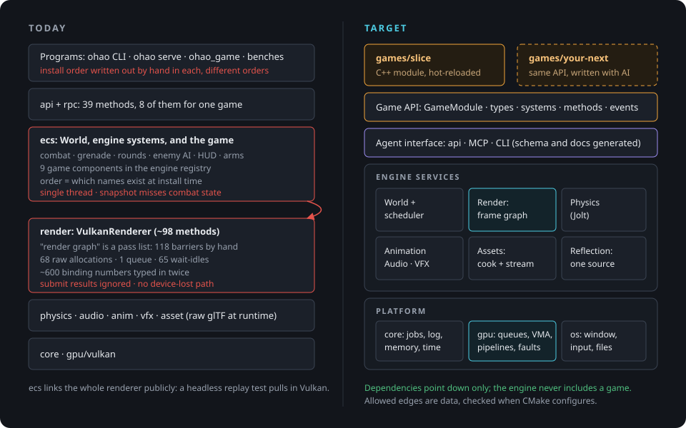
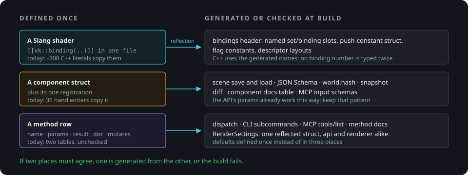
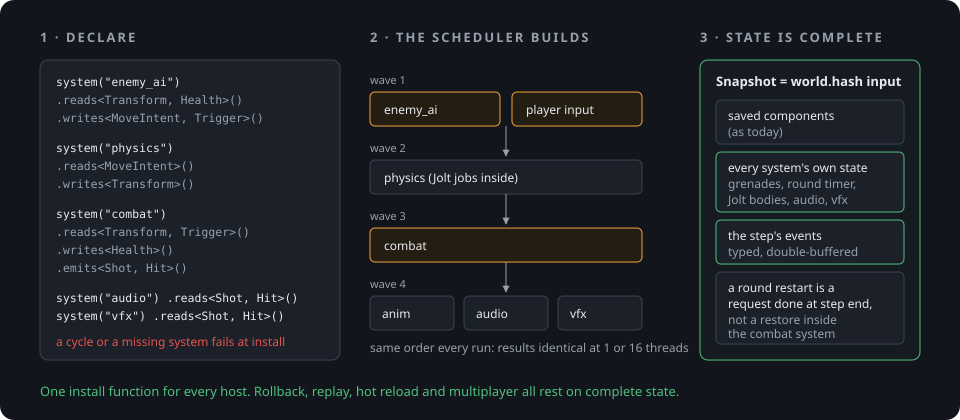
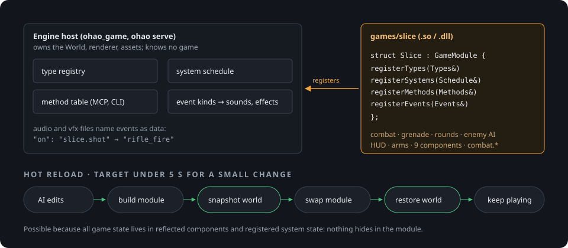
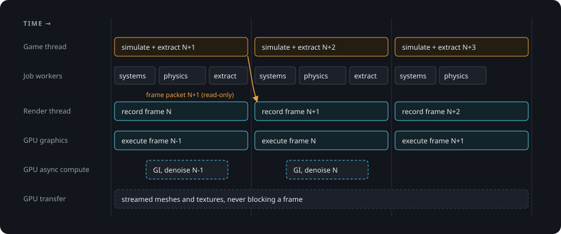
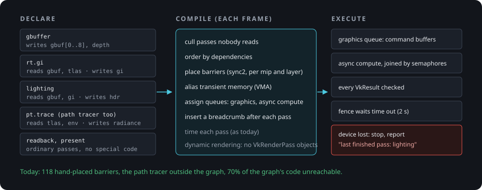
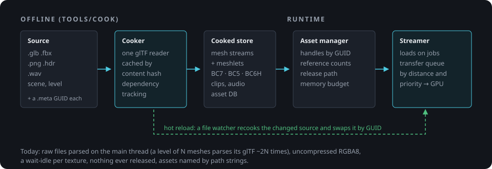
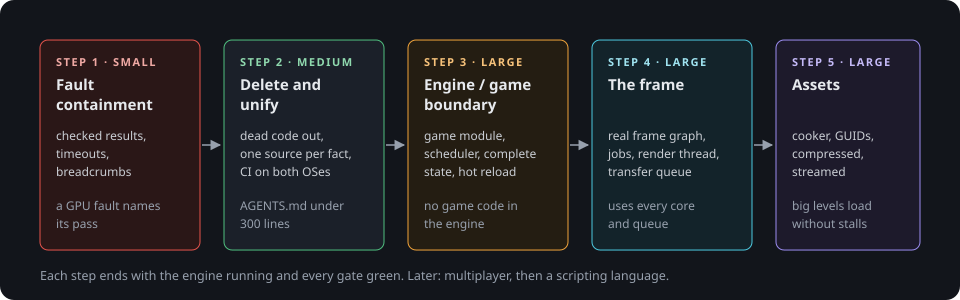

# OHAO system design

**Status:** proposed, 2026-11-08 (Frank and Claude). Supersedes nothing yet: each step below gets its own plan in
`docs/plans/` before it is built.

**Sources:** five read-only surveys of the tree at `d0b4b60f` (runtime, renderer, data and assets, gameplay, tooling
and process), 2026-11-08. Every number below is from them or from a run that day.

## 1. Requirements

Frank's, 2026-11-08. They decide what "good design" means here; nothing below is justified by anything else.

1. **OHAO is built by Frank and AI agents**, with the latest state of the art, to deliver Frank's opinionated
   experience. He builds games with it, more than one.
2. **Other people build games with it through AI.** There is no visual editor (too expensive): the agent interface
   is the editor.
3. **Singleplayer first.** Multiplayer later, once the basics stand.
4. **Windows first**, Linux too: Vulkan runs on both.
5. **Performance like Call of Duty.**
6. **Games are written in C++.** A scripting language comes when the engine is mostly done, if a need appears.

## 2. Principles

1. **One source per fact.** When two places must agree, one is generated from the other or the build fails.
2. **Rules live in code.** A type, a generated file, a `static_assert` or a configure check, never only a sentence.
   The builders are agents that forget between sessions: a rule in prose is a rule the next agent breaks.
   `AGENTS.md` keeps only what code cannot enforce.
3. **The engine knows no game.** Games are C++ modules against a public game API.
4. **Declared data flow.** Systems and render passes declare what they read and write; the schedulers derive order,
   barriers and parallelism from that. Nothing is ordered by which names happen to exist.
5. **Complete state.** Everything the simulation reads next step is in the snapshot and in `world.hash`. Replay,
   rollback, hot reload and later multiplayer all rest on it.
6. **Every piece of work is bounded, checked and attributable.** A GPU fault names the pass that was running.
7. **The feedback loop is the editor.** Without a visual editor, how fast an agent sees the result of an edit is the
   product: hot reload of game code, assets and shaders, and errors that say what to fix.
8. **Delete before adding** (Musk's order: question the requirement, delete, simplify, speed up, automate).

## 3. Where we are

### Keep: already at a good level

- GPU-driven rendering: GPU culling, meshlets, bindless textures; OpenPBR shading; ReSTIR direct light and RT GI.
- The path tracer as the reference, held to closed forms (`check_analytic`, `check_material`).
- The deterministic simulation: fixed step, id-ordered iteration, counter-based random numbers, integer animator
  state, stable 64-bit entity ids, `world.hash`, snapshots, exact replay.
- The API's parameters: each is one reflected struct that gives the decoder, its validation, the JSON Schema and
  the MCP input schema. This is the pattern for the whole engine.
- Slang modules; the path tracer's pipeline disk cache; Jolt behind `PhysicsScene`.

### Five structural problems

**1. Facts are defined in several places and kept in sync by hand.**
- About 300 binding numbers in C++ and 292 in Slang, typed separately; `layout.json` holds none.
- The path tracer's push constants and flag bits are written twice, and their comments already disagree
  (`path_tracer.hpp:517` against `path_tracer.slang:80`).
- `RenderSettings` exists in three shapes with converters both ways; one new render setting touches about six
  places.
- 36 hand-written scene writers repeat the component registrations; the check that compared them (`scene_tests`
  t21) was deleted in the test cut of 2026-11-08 (`7e7211cf`).
- The API's doc table and dispatch table are separate and unchecked.
- The install sequence is copied into six programs in different orders. The window and the CLI run their sync
  systems in different orders, and physics' snapshot hook would be lost silently if it were installed after audio
  or vfx (`ctx().emplace` keeps the existing hook).

**2. The frame has no architecture.**
- The render graph is a pass list. It keeps insertion order (`render_graph.cpp:575`), culls nothing, aliases
  nothing; about 70% of its code is unreachable. 6 of its at most 12 nodes declare resources. Everything after
  lighting, and the whole path-tracer frame, records outside it.
- 118 `vkCmdPipelineBarrier` call sites, one of them the graph's.
- 68 raw `vkAllocateMemory` calls beside VMA; 13 `VkRenderPass` objects; one queue; 17 `vkQueueWaitIdle` and 48
  `vkDeviceWaitIdle` sites, uploads included.
- `PathTracer::render` is 926 lines, `DeferredRenderer::render` 392; `VulkanRenderer` has about 98 methods, half its
  `.cpp` ten copies of one readback.

**3. No fault containment.**
- `vkQueueSubmit`'s result is ignored (`render_dispatch.cpp:220, 413`); fence waits never time out; there is no
  device-lost path, no `VK_EXT_device_fault`, no breadcrumbs; the window loop catches no exception.
- Nothing bounds a dispatch's total work; "never ship an unbounded dispatch" is a sentence in `AGENTS.md`.
- On Linux the GPU's firmware failed seven times during GPU work (`AGENTS.md`, the GSP entry). Whatever the cause,
  the engine cannot say which pass was running.

**4. The engine and the game are tangled, on one thread.**
- The game is compiled into `ohao_ecs`: combat, the test grenade, rounds, enemy AI, the arms and enemy animation
  drivers, the HUD, 9 game components in the engine registry, 8 game methods (`combat.*`, `player.*`). The audio
  schedule and the vfx format have combat events built in.
- Systems run in insertion order; installers probe which names exist; a missing anchor appends silently.
- The simulation writes the live `RenderScene` the renderer reads; no job system (Jolt runs with 0 workers); one
  `InputMap` and one player per World.
- Combat's runtime state (grenades in flight, the round timer) is in no snapshot; a round restart is a whole-world
  restore inside the combat system; animation assumes 1/60 s whatever `dt` is.
- `ohao_ecs` links the renderer publicly: the headless replay test pulls in Vulkan.

**5. No content pipeline.**
- Source files are parsed at runtime on the main thread; a level of N meshes parses its glTF about 2N times; FBX
  is parsed twice (ufbx, then Assimp).
- Textures are uncompressed RGBA8, one allocation, staging buffer and queue wait each; nothing is ever released;
  the CPU cache is never evicted; assets are named by path strings (`AssetRef.guid` is never set).
- Three JSON libraries and three glTF readers.

**The process has the same shape.** No CI for code (`.github/workflows` deploys the monograph only). `AGENTS.md`
is 1,196 lines, 88% of it rules the code does not check, loaded into every agent session. Headers promise what
does not exist (a C ABI, an editor, hot reload, a full render graph); docs describe deleted code (`impact_marks`,
the gpu→render cycle). Since 2026-10-22: 500 commits, more of them `docs` than `feat`, and large reversals (Godot
added and removed, 74 tests built and cut to 10).

## 4. Target architecture

### 4.1 Layers

| Layer | Libraries | Knows |
|---|---|---|
| Games | `games/<name>` (one module each) | the game API |
| Game API | `ohao/game` | engine services, through narrow headers |
| Agent interface | `ohao/api`, `ohao/rpc`, `tools/ohao` | engine services, the game API's registries |
| Engine services | world (ECS, scheduler, snapshot), render, physics, anim, audio, vfx, asset, reflect | platform |
| Platform | core (jobs, log, memory, time), gpu (device, queues, VMA, pipelines, faults), os (window, input, files) | nothing above |

- Dependencies point down only. The allowed edges are a table in CMake, and configure fails on an `#include` that
  breaks it (a scan of each library's sources).
- The world does not link the renderer. Render handles move out of components into a render-side map keyed by
  entity, filled by the extract.

### 4.2 One source per fact

- **Shader bindings** come from Slang's reflection API at build time: one generated header per shader with named
  set and binding slots, the push-constant struct and the flag constants. C++ names slots; it never types a number.
  `layout.json` stays for the shared structs until reflection covers them too, and `gen_layout --check` runs at
  configure.
- **Components:** the struct and its one registration. Save, load, schema, hash, snapshot, diff, the docs table and
  the MCP schemas come from the registration. The 36 hand writers go if the generic writer is within the save budget
  (10 ms on bench10k); measured first, else generated at build.
- **Methods:** one row each (name, params, result, doc, mutates) feeds dispatch, the CLI, `tools/list` and the docs.
- **`RenderSettings`:** one reflected struct, shared by the API and the renderer, its defaults written once.
- **Install:** one `installEngine(World&, EngineConfig)` for every host; hosts differ by config, never by sequence.

### 4.3 The world: scheduler, state, events

- A system declares its phase, the components and resources it reads and writes, and the events it emits and reads.
  The scheduler builds a graph once, at install: a cycle, a missing dependency or two writers of one component
  without an order fail there. Systems whose accesses do not conflict share a wave; waves run in a fixed order, so the
  results are identical at any thread count. Step 3 runs the waves serially; step 4 runs them on jobs.
- **Complete state.** A system with private state registers it (save, restore, hash). The snapshot and `world.hash`
  cover components, every registered state (grenades in flight, the round timer, Jolt's bodies, the audio schedule,
  vfx records) and the step's events.
- **Events** are typed and double-buffered per step (`Events<Shot>`), replacing the per-system logs and the "read
  after the step's last restart" rule. A round restart becomes a request carried out at the end of the step.
- **One clock.** Every system steps by the World's fixed `dt`; animation stops assuming 1/60 s.
- **Input per player.** Input streams are keyed by player, not one `InputMap` per World. Singleplayer has one stream;
  multiplayer later needs no redesign.

### 4.4 The engine/game boundary

- `ohao/game` is the public game API: a `GameModule` with `registerTypes`, `registerSystems`, `registerMethods`
  and `registerEvents`, and the narrow engine services a game may call (spawn, query, raycast, play, effects).
- A game is a shared library under `games/`, built by the same CMake with the same compiler and flags as the engine
  (no binary ABI promise). The current slice moves to `games/slice`: combat, grenade, rounds, enemy AI, the arms and
  enemy drivers, the HUD, the view model, its 9 components and its methods.
- Audio banks and vfx sets bind sounds and effects to event names as data (`"on": "slice.shot"`); the engine's code
  names no game event.
- **Hot reload:** build the module, snapshot the world through reflection, unload, load, restore, continue. It works
  because a module keeps no state outside reflected components and registered state. Target: under 5 s from edit to
  playing for a small change.
- **Two audiences, two kinds of docs.** Engine developers read a short `AGENTS.md` and `ARCHITECTURE.md`. Game
  developers' agents read the game API's headers and a catalogue generated from the registries (components,
  methods, events, schemas), never the engine's internals.

### 4.5 Threads and the frame

- **Game thread:** steps the world and ends each frame with an extract into an immutable **frame packet** (draws,
  lights, camera, effects, the HUD list).
- **Render thread:** records frame N from packet N while the game thread simulates N+1; the GPU executes N-1.
  Nothing the renderer reads is written by the simulation while it reads it.
- **Job system:** a work-stealing pool; the scheduler's waves, Jolt (through Jolt's own `JobSystem` interface),
  culling preparation, meshlet building, the cooker and the streamer run on it. Jolt's determinism with N workers is
  checked by `replay_test` at 1 and at N workers before it is relied on; Jolt's `CROSS_PLATFORM_DETERMINISTIC`
  option is measured for the MSVC/GCC ulp difference.
- **RPC** keeps its reader thread and posts commands into the step's queue, as `input.inject` does.

### 4.6 The renderer

- **A frame graph that owns every pass:** deferred, path tracer, post, readback, present. A pass declares the
  images and buffers it creates, reads and writes; the compiler culls, orders by dependency, places `sync2` barriers
  per mip and layer, aliases transient memory through VMA, assigns graphics or async compute, and puts a breadcrumb
  after each pass. Dynamic rendering replaces the 13 `VkRenderPass` objects.
- **All memory through VMA.** No raw `vkAllocateMemory`.
- **Descriptors:** one global bindless table (textures, samplers, buffers by device address) plus a per-pass
  parameter block whose C++ struct is generated from the shader (4.2). The 31 descriptor pools and 34 layouts go.
- **Pipelines:** one pipeline library creates every pipeline through one disk cache and hot-reloads a changed shader
  at a frame boundary. Shader dependencies are per module, not every SPIR-V on every `.slang`.
- **Uploads** go through a transfer queue with timeline semaphores. `WaitIdle` is allowed at resize and shutdown
  only.
- `PathTracer::render` and `DeferredRenderer::render` become graph passes; readback is a pass type, not ten
  functions.

### 4.7 Fault containment

- Every `VkResult` from submit, present, acquire and waits is checked.
- Fence waits time out at 2 s (Windows' TDR delay) and are treated as a hang.
- On device loss: stop rendering, report the last breadcrumb (`VK_NV_device_diagnostic_checkpoints` on NVIDIA, else
  a marker buffer written after each pass), the `VK_EXT_device_fault` report where supported, then exit cleanly.
- The window loop catches what escapes a frame and shuts down in order.
- A dispatch's total work is bounded by design: per-lane loop caps exist; features whose work varies by orders of
  magnitude (caustics step 2b's re-find walks) are split into bounded rounds.
- A window's frame rate is capped (default: the display's refresh rate; a setting raises it). Today mailbox and
  immediate present uncapped: on 2026-11-08 `feel_bench`'s 1080p window took an RTX 5070 Laptop from 65 to 87 C in
  about a minute. A game running a laptop GPU at full power for frames nobody sees breaks requirement 1.

### 4.8 Assets

- **Asset database:** a GUID per source file in a `.meta` beside it, dependencies between assets, content hashes.
  Scenes refer to GUIDs; paths are for people.
- **Cooker** (`tools/cook`, on jobs, cached by content hash): mesh streams split for depth and RT, meshlets prebuilt;
  textures compressed (BC7, BC5 for normals, BC6H for HDR) with mips, in KTX2; clips; audio. One glTF reader, in the
  cooker only.
- **Runtime:** an asset manager with handles, reference counts and a release path; a streamer that loads on jobs and
  uploads through the transfer queue, by distance and priority, under a memory budget.
- **Hot reload:** a file watcher recooks the changed source and swaps it by GUID.
- One JSON reader (simdjson) and our writer; nlohmann goes where nothing else needs it.

### 4.9 Build, CI, platforms

- CI on every push (GitHub Actions): Windows (MSVC) and Linux (GCC) builds, the CPU gates (`replay_test` and the
  consistency checks the generated code makes possible). GPU gates on a self-hosted runner when one exists.
- Every dependency pinned to a tag or commit (stb is on `master` today); dead ones deleted (`tinyfiledialogs.cmake`).
- Windows-only paths and presets kept only where Windows needs them; `CMakePresets.json` gets a Linux preset.

## 5. Migration

Each step gets a plan in `docs/plans/` and ends with the engine running and every gate green. No full rewrite: the
shading, the path tracer and the deterministic simulation stay; the skeleton around them is replaced piece by piece.

**Step 1, fault containment (small).** Check every result; fence timeouts; a device-lost path with breadcrumbs and
`VK_EXT_device_fault`; a catch around the window loop; a frame-rate cap in windows.
*Done when* an injected `VK_ERROR_DEVICE_LOST` at the submit wrapper and an injected hang (a fence never submitted)
each produce a report naming what each frame in flight ran and an exit within 2.5 s. A real GPU fault is not caused on
purpose (it risks the machine, requirement 1): its report is checked when one happens.

**Step 2, delete and unify (medium).**
- Delete: the graph's unreachable allocator, render-pass and framebuffer code; the ten readbacks (one remains);
  `EventBus`, `CommandHistory`, `core.hpp`; the hot-reload stubs; single-implementation interfaces
  (`IGITechnique`, `IReflectionTechnique`); `Model`'s LOD stubs; `tests/scenes/invalid/` without a consumer; stale
  header claims and docs (C ABI, editor, `impact_marks`, the gpu→render cycle).
- Unify: generated bindings (4.2); one method table; one `RenderSettings`; one `installEngine`; install-time
  ordering errors; the scene writers decided by measurement; the dependency check at configure.
- `AGENTS.md` under 300 lines: each rule becomes code or is deleted.
- CI on both systems.

*Done when* C++ holds no literal binding number, every host installs through one function, `AGENTS.md` is under 300
lines, and CI is green on Windows and Linux.

**Step 3, the engine/game boundary (large).** The game API; `games/slice` as a module; the declared scheduler
(serial); complete state and typed events; the round restart as a request; one `dt`; input per player; event names as
data; the world without the renderer; hot reload of the module.
*Done when* the engine libraries hold no game code, `replay_test` passes with the slice as a module, a hot reload keeps
`world.hash`, and a second minimal game builds against the same API.

**Step 4, the frame (large).**
- 4a: the frame graph over every pass, VMA everywhere, dynamic rendering, the bindless table and generated parameter
  blocks, the pipeline library with shader hot reload, the transfer queue.
- 4b: the job system, parallel waves, Jolt on jobs, the frame packet and the render thread.

*Done when* no barrier is placed outside the graph, `render_bench` is no slower on any scene, `replay_test` is
identical at 1 and N threads, and the play scene's CPU frame time drops with more cores (measured).

**Step 5, assets (large).** The asset database, the cooker, compressed textures, the asset manager with release, the
streamer, hot reload by GUID.
*Done when* the play scene loads from cooked data faster than from source (measured), its texture memory drops by the
compression ratio, loading has no `WaitIdle`, and a load-unload loop returns memory to its baseline.

**Later:** multiplayer (server authority, prediction, lag compensation) on the complete state of step 3; a scripting
language when the engine is mostly done.

**Feature work during the migration.** Caustics step 2c's GPU pass waits for step 4a: built on today's frame it
would be built twice. Its CPU solver (`901b4a37`) is done and stays.

## 6. Decisions

**Taken (Frank, 2026-11-08):** the requirements in section 1; C++ for games; no visual editor; singleplayer first;
the order of section 5, with the boundary before the frame because games are built by other people's agents.

**Open, each decided by measurement in its step's plan:**
- The job system: our own work-stealing pool, or enkiTS (zlib) or Taskflow (MIT).
- The scene writers: the generic reflection writer if it meets the 10 ms save budget on bench10k, else generated.
- The texture compressor and container: bc7enc_rdo or Compressonator, KTX-Software for KTX2.
- Descriptor buffers (`VK_EXT_descriptor_buffer`) or classic descriptor sets for the bindless table.
- Jolt's `CROSS_PLATFORM_DETERMINISTIC`: its cost against matching hashes across MSVC and GCC.

## 7. Not doing

- A visual editor; a scripting language now; networking now.
- A rewrite from scratch.
- New gates per step: a step proves itself by measurement and the five gates (`AGENTS.md`, "Gates").

## 8. References

- Yuriy O'Donnell, "FrameGraph: Extensible Rendering Architecture in Frostbite", GDC 2017.
- Unreal Engine 5, the Render Dependency Graph (RDG) documentation.
- Christian Gyrling, "Parallelizing the Naughty Dog Engine Using Fibers", GDC 2015.
- Natalya Tatarchuk, "Destiny's Multithreaded Rendering Architecture", GDC 2015.
- Timothy Ford, "Overwatch Gameplay Architecture and Netcode", GDC 2017.
- Bevy's ECS schedules: systems declare their access, the scheduler runs non-conflicting ones in parallel.
- Slang's reflection API; Vulkan `VK_EXT_device_fault`, `VK_NV_device_diagnostic_checkpoints`; NVIDIA Nsight
  Aftermath.
- Unreal's Live Coding (hot reload of C++ modules).
